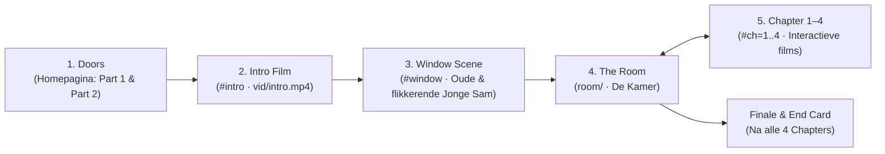
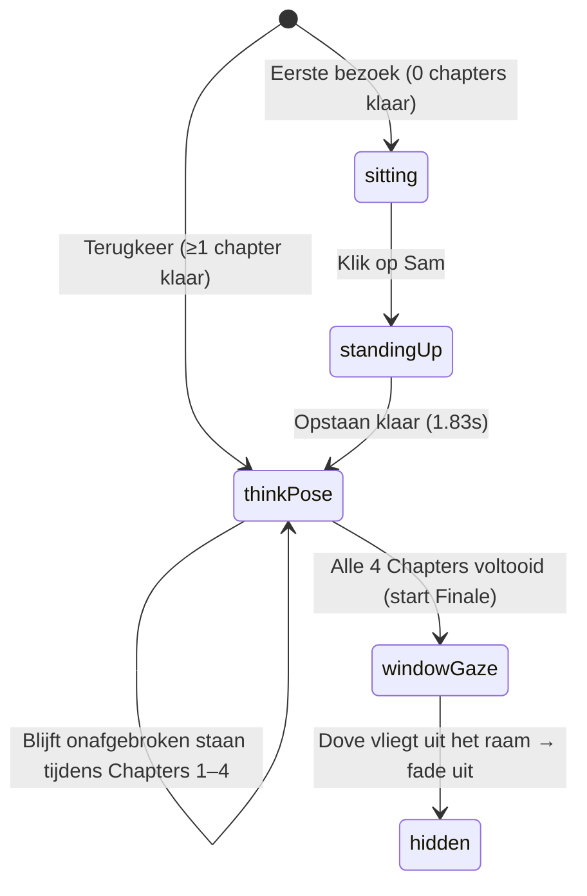

# Shared Terminology, States & Flow Map

Dit document legt de **gedeelde taal en exacte states** vast voor *We All Breathe The Same Air*. Zo heet elk scherm, elke pose van Sam, elk hoofdstuk-onderdeel en elke tekstlaag in gesprek én in de code hetzelfde.

*(Zie ook [`GLOSSARY.md`](file:///Users/maarten/Github_may_be_deleted/LikeDust_Part2/GLOSSARY.md) voor de compacte domeindefinities.)*

---

## 1. De 5 Ruimtes (`Spaces`) van de Applicatie

| Term | Wat het is | URL / Route |
| :--- | :--- | :--- |
| **`Doors`** | De gesplitste startpagina met *Part 2 (We All Breathe The Same Air)* en *Part 1 (Like Dust)*, met stille achtergrondvideo's op desktop én mobiel. | `/` (of `/room/` op review-dashboard) |
| **`Intro Film`** | De proloogfilm (`1:13`) die start zodra je op `Start` klikt. | `/#intro` (of `/intro/`) |
| **`Window Scene`** | Het vliegveldraam waar volwassen Sam naar de **flikkerende reflectie van jonge Sam** kijkt. Klikken op jonge Sam opent *The Room*. | `/#window` |
| **`The Room`** | Sams kamer (Three.js 2D). Het centrale punt waar de tijd van middag naar avond schuift en de 4 `Chapter Objects` klaarliggen. | `/room/` |
| **`Chapter 1–4`** | De vier interactieve film-afleveringen die vanuit *The Room* openen met een rustige zwarte fade. | `/room/#ch=1` t/m `#ch=4` |

---

## 2. Sam in `The Room`: Slechts 4 Exclusieve Poses (`SamPose`)

Sam heeft **géén tussen-animaties** bij objecten (geen paspoort-denkreactie, geen fotolijstje oppakken, geen geld tellen, geen poster uitrollen). Zijn state-machine kent exact deze 5 waarden, waarvan er altijd **maar één tegelijk** zichtbaar kan zijn:

| `SamPose` naam | Betekenis | Gebruikte sprite |
| :--- | :--- | :--- |
| **`sitting`** | **Sitting Pose** — Sam zit stil op het onderbed bij de allereerste binnenkomst. | `standup.webp` (frame 0) / `man.png` |
| **`standingUp`** | **Stand-Up** — De éénmalige begin-animatie waarin Sam opstaat van het bed en het zonlicht instapt (`0s → 1.83s`). | `standup.webp` (deel 1) |
| **`thinkPose`** | **Think Pose** — Sams vaste staande houding (hand onder zijn kin in de zonnestraal). Hij blijft in deze pose staan gedurende alle hoofdstukken tot aan het einde. | `idle.webp` (loop) |
| **`windowGaze`** | **Window Gaze** — De éénmalige eind-animatie na Hoofdstuk 4 waarin Sam zich omdraait en uit het raam kijkt (`1.83s → 5.08s`), vlak voor de **Dove** naar buiten vliegt. | `standup.webp` (deel 2) |
| **`hidden`** | Sam is zacht uitgefaded aan het slot van de **Finale** terwijl de camera op het raam inzoomt naar de *End Card*. | *(geen)* |

---

## 3. Kamer-flow (`RoomFlow` State Machine)

De besturing van *The Room* in `room/shared/fsm.js`:

| `RoomFlow` state | Wat de speler ziet & kan doen |
| :--- | :--- |
| **`prologueSitting`** | Sam zit op bed (`sitting`), gouden cirkel pulseert op Sam. Alleen Sam is klikbaar. |
| **`standingUp`** | Sam staat op (`standingUp`). Invoer kort geblokkeerd tot hij in `thinkPose` staat. |
| **`roomIdle`** | Sam staat in `thinkPose`. Ontgrendelde `Chapter Objects` zijn klikbaar; gouden cirkel wijst het eerstvolgende hoofdstuk aan. |
| **`chapterTransitionIn`** | Zwarte fade-in (`wipe`), kamer-audio fadet uit, hoofdstuk wordt klaargezet. |
| **`chapterActive`** | Hoofdstuk draait fullscreen (`#ch=1..4`), kamer-renderloop gepauzeerd en `inert`. |
| **`chapterTransitionOut`** | Terugkeer uit hoofdstuk (zwarte fade-out), kamer-tijd/licht/krijtbord/brievenstapel schuiven door, Sam staat direct in `thinkPose`. |
| **`finale`** | Start na voltooiing van alle 4 hoofdstukken: `windowGaze` → `Dove` vliegt uit raam (`birdout.mp4`) → raam-zoom. |
| **`endCard`** | *The End* scherm met `Start again` en `← Home`. |

---

## 4. De 4 `Chapters`, `Chapter Objects` & `Moments`

Elke **Chapter** bestaat uit filmsegmenten (`Segments`) die pauzeren op interactieve **Moments**:

| # | `Chapter` | `Chapter Object` in de Kamer | `Moments` (pauzemomenten in de film) |
| :--- | :--- | :--- | :--- |
| **1** | **Schiphol** | **Passport** *(Paspoort op voorgrondtafel)* | 1. `breath` (*Adem inhouden*) 2. `silence` (*Het verhoor*) 3. `wall` (*Cell Wall / De celmuur*) 4. `mother` (*Naar huis bellen*) 5. `photo` (*Foto & Yellow Card*) |
| **2** | **The AZC** | **Photo Frame** *(Fotolijstje rechtsvoor)* | 1. `call` (*Telefoon naar moeder*) 2. `letter` (*Brief lezen*) 3. `hide` (*Onder de deken verstoppen*) 4. `truth` (*Waarheid of zwijgen*) 5. `lock` (*Deur op slot*) 6. `bird` (*Gewond vogeltje*) |
| **3** | **Amsterdam** | **Bicycle** *(Fiets achter het bed)* | 1. `card` (*AZC-pasje verbranden*) 2. `bike` (*Fietsroute door de stad*) 3. `bread` (*Werk / brood*) |
| **4** | **The Letter** | **Rejection Letter** *(Brief aan linker muur)* | 1. `water` (*Onder water / verdrinken*) 2. `coins` (*Munten / wind*) 3. `erase` (*Nummer op Yellow Card uitwissen*) |

---

## 5. Tekstlagen & Meertaligheid (`en` · `nl` · `fa`)

| Term | Waar zichtbaar | Gedrag bij `en` (Engels) | Gedrag bij `nl` (Nederlands) & `fa` (Farsi) |
| :--- | :--- | :--- | :--- |
| **`Burned-in English`** | Ingebrand onderin alle video's (`intro.mp4` + hoofdstuk-films) | Zichtbaar zoals in de video | Wordt standaard afgedekt door de donkere **`Subtitle`**-balk onderin het 16:9 kader |
| **`Subtitle`** | Ondertitelbalk (`.big`) onderin de video | **Uitgeschakeld** (geen dubbele tekst, `CC`-knop verborgen) | **Standaard AAN** met de tijdgecodeerde `nl` of `fa` (`RTL` + `Vazirmatn`) vertaling uit `i18n/{nl,fa}.json`, inclusief een **`CC`-toggleknop** in de videobalk om ze handmatig uit/aan te kunnen zetten |
| **`Sam's Voice`** | Woord-voor-woord gedachte tijdens een **Moment** (`.voice`) | Alleen Engels (géén losse hardcoded Farsi regels meer eronder) | Nederlands (`nl`) of Farsi (`fa`, rechts-naar-links) |
| **`Action Prompt`** | Korte instructie bij een **Moment** of in de **Window Scene** (`.ask` / `.hint`) | Engels | Nederlands (`nl`) of Farsi (`fa`) |
| **`Room Caption`** | Korte zin bovenin **The Room** (`#caption`) | Engels | Nederlands (`nl`) of Farsi (`fa`) |
