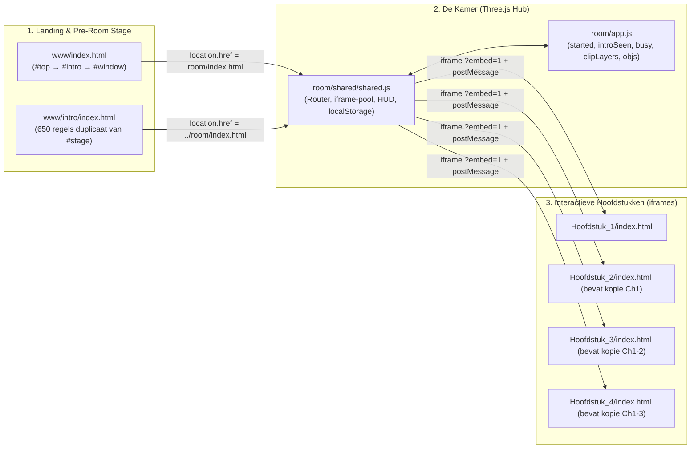
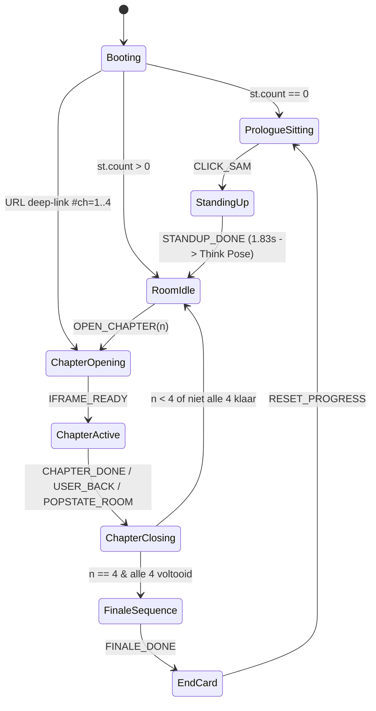

# 02 · State, Flow & Terug-navigatie Architectuur (Hebben we XState nodig?)

Dit document analyseert hoe state en terug-navigatie momenteel door de applicatie lopen, waar kwetsbaarheden en duplicatie zitten, en of een library zoals **XState** nodig of wenselijk is.

---

## 1. Huidige Architectuur & Knelpunten

De app bestaat momenteel uit **drie losse HTML-documenten / lagen** die state op **vijf plekken** bijhouden:



### Vijf concrete structurele zwaktes in de huidige flow

1. **Losse boolean-vlaggen i.p.v. exclusieve states (`room/app.js` & `shared.js`):**
   - In `app.js` bepalen `started`, `roomRevealed`, `introSeen`, `busy`, `reacting`, `birdBusy`, `LD.busy`, `objs.man.gone` en `clipLayers[]` samen wat er op het scherm staat.
   - Omdat er geen centrale invariant is (zoals *"Sam kan maar in één pose tegelijk zijn"*), ontstaan combinaties die eigenlijk onmogelijk horen te zijn — zoals **Dubbele Sam** (`standup` op frame 0 + `idle` tegelijk zichtbaar).

2. **`history.back()` + `180ms` timer-race bij sluiten van een hoofdstuk ([`shared.js:355-360`](file:///Users/maarten/Github_may_be_deleted/LikeDust_Part2/Capacitor_Apps/app-room/www/room/shared/shared.js#L355-L360)):**
   ```js
   if (pushedChapterHistory) {
     pendingCloseEnded = ended;
     pushedChapterHistory = false;
     history.back();
     setTimeout(() => { if (!done) { setUrlRoute({ type: "room" }, true); performClose(ended); } }, 180);
     return;
   }
   ```
   Op mobiele browsers duurt `history.back()` → `popstate` soms >180ms (zeker tijdens video-teardown). Dan voert de `setTimeout` al `replaceState` + `performClose` uit, waarna de vertraagde `popstate` alsnog binnenkomt of een extra stap terug in de browsergeschiedenis doet.

3. **Deep-link terug-navigatie & ontbrekende `inert` focus-isolatie (`modern-web-guidance` `stack-drill-down` & `html`):**
   - Wie rechtstreeks binnenkomt op `https://thesameair.nl/room/#ch=1` en op Browser Back drukt, verlaat de site in plaats van naar de kamer terug te keren als `history.state` geen diepte bijhoudt.
   - Wanneer `#stage`, `#cinema`, `.card` of `.ld-chapter` open staat, krijgt de onderliggende laag geen HTML `inert`-attribuut, waardoor toetsenbordfocus en screenreaders naar verborgen knoppen (`#hots`) kunnen lekken.

4. **DOM-polling tussen Kamer en Hoofdstuk-iframe ([`shared.js:339`](file:///Users/maarten/Github_may_be_deleted/LikeDust_Part2/Capacitor_Apps/app-room/www/room/shared/shared.js#L339)):**
   - `shared.js` pollt elke `800ms` via `o.fr.contentDocument.getElementById("cardEnd")`, terwijl het hoofdstuk óók al een `MutationObserver` heeft die `postMessage("ld-room-back")` stuurt ([`Hoofdstuk_1:2191`](file:///Users/maarten/Github_may_be_deleted/LikeDust_Part2/Capacitor_Apps/app-room/www/room/chapters/Hoofdstuk_1_Schiphol/index.html#L2191)). Daardoor kunnen twee sluit-paden tegelijk vuren (`ended = true` via poll vs. `ended = false` via `ld-room-back`!).
   - **Let op deze subtiele bug:** In `shared.js:90` roept `if (e.data === "ld-room-back") o.close(true)` altijd `ended = true` aan — óók als een speler na 2 seconden op **`← Back to the room`** klikt vanuit de hoofdstuk-balk (`[data-room]`)! Daardoor wordt een hoofdstuk al als "voltooid" gemarkeerd zelfs als je meteen op *Back* drukt!

5. **Grote code-duplicatie (onderhoudsrisico bij bugs & Farsi vertaling):**
   - `www/index.html` en `www/intro/index.html` bevatten ~650 regels dezelfde `#stage`-code.
   - `Hoofdstuk_2`, `Hoofdstuk_3` en `Hoofdstuk_4` bevatten elk de volledige gekopieerde JS/CSS/interacties van alle voorgaande hoofdstukken (samen ~9.500 regels waar ~2.500 gedeelde runtime + 4 kleine hoofdstuk-configs genoeg zijn).

6. **Verschil tussen huidige `docs/FEATURES_AND_HIGHLIGHTS.md` en `room/app.js`:**
   - In [`docs/FEATURES_AND_HIGHLIGHTS.md`](file:///Users/maarten/Github_may_be_deleted/LikeDust_Part2/docs/FEATURES_AND_HIGHLIGHTS.md#L21-L36) staan kamer-reacties beschreven (`think` bij paspoort, `frame` oppakken bij foto, `bike` + `countMoney` geld tellen na hoofdstuk 3, `unrollPoster` + `sad` bij brief, en `silhouette()` masker-zoom).
   - In de huidige [`triggerChapter()` in `room/app.js:1978-2048`](file:///Users/maarten/Github_may_be_deleted/LikeDust_Part2/Capacitor_Apps/app-room/www/room/app.js#L1978-L2048) staan deze functies wel volledig geprogrammeerd in het bestand, maar gaat `triggerChapter()` direct via een zwarte fade (`wipe("#000")`) naar het hoofdstuk zonder die animaties aan te roepen. *(In de Grill-sessie stemmen we af of dit bewust versimpeld is of hersteld moet worden.)*

---

## 2. Hebben we een library zoals XState nodig?

### Vergelijking van de opties

| Criterium | Optie A: Losse booleans houden (huidig) | Optie B: **Eigen lichtgewicht FSM (`shared/fsm.js`, ~100 regels, 0 deps)** *(Aanbevolen)* | Optie C: **XState v5** (`xstate`, ~18–30 KB min+gzip) |
| :--- | :--- | :--- | :--- |
| **Build-tooling nodig?** | Nee | **Nee** (puur ES6 script, werkt direct in `www/`, Cloudflare Pages & Capacitor) | Lastig zonder bundler (ESM importmaps of UMD build nodig in zowel landing, kamer als iframes) |
| **Voorkomt onmogelijke states (Dubbele Sam, dubbele close)?** | Nee | **Ja, 100%** (één actieve state per machine + `onEnter`/`onExit` cleanup + transition-tokens) | Ja, 100% |
| **Past bij omvang van de state-graaf?** | Te fragiel | **Precies op maat** (de app heeft ~8 hoofdstates en ~6 Sam-poses, geen tientallen parallelle actors) | Overkill; XState schittert bij complexe formulier-/workflow-apps met React/Vue-integratie, maar lost WebGL/iframe/iOS-media cleanup niet vanzelf op |
| **Debugbaarheid (`?dev=1`)** | Lastig | **Uitstekend** (`window.LD.stateMachine.getState()`, event-log in console/HUD, deterministische history-sync) | Uitstekend (Stately Inspector, mits gebundeld) |
| **Onderhoud & leesbaarheid** | Laag | **Zeer hoog** (~100 regels eigen code zonder externe lock-in) | Middel (nieuwe developers moeten XState v5 actor-syntax kennen) |

### Conclusie & Aanbeveling
**Nee, een zware externe library zoals XState v5 is niet nodig** (en introduceert onnodige bundler-/module-frictie in deze bewust bundler-vrije Capacitor/static-web stack).

**Wél hebben we het *patroon* van XState nodig:** een **kleine, expliciete Finite State Machine (`www/room/shared/fsm.js`, ~100 regels, zero-dependency)** met twee heldere state-machines en één deterministische History-controller.

---

## 3. Doel-architectuur voor State & Terug-navigatie

### Machine 1: `RoomFlow` (Applicatie- & Navigatiestate in de Kamer)

*(Afgestemd in Grill Ronde 1: géén tussen-animaties of 15s idle-reacties meer — Sam staat na `Stand-Up` onafgebroken in zijn `Think Pose` tot aan de `Finale`.)*



### Machine 2: `SamPose` (Visuele invariant in `room/app.js`)
Eén enkele bron van waarheid voor Sam in Three.js met **slechts 5 waarden**:
- Toegestane states: `'sitting' | 'standingUp' | 'thinkPose' | 'windowGaze' | 'hidden'`
- **Harde invariant:** Elke transitie naar state `X` zet `objs.man` én alle andere `clipMeshes[y !== X]` direct naar `target = 0` (en bij `instant` / `resume` direct `alpha = 0; visible = false`). Dubbele Sam kan hierdoor wiskundig niet meer voorkomen.

### Op te ruimen tussen-animaties & ongebruikte bestanden in `www/room/` (Q4 & Q7)
- **Blijft behouden in de kamer (Q7):**
  - Stille kamer-props: `money.png` (verschijnt stil op tafel bij Hoofdstuk 3, zonder tel-/fladder-animatie) en `reject_rolled.png` → `reject_open.png` (hangt opgerold vóór Hoofdstuk 4 en open met `REJECT`-stempel zodra Hoofdstuk 4 geopend/gezien is, zonder uitrol-animatie).
  - Kamersfeer: zonnestralen (`raysA`/`raysB` + avondkleuring), stofdeeltjes (`dustPoints`), Nederlands krijtbord + groeiende brievenstapel (`timeProgression`), en de **Dove** (`bird.png`, `pigeon.webp`, `birdout.mp4`).
- **Code weg uit `app.js` & `shared.js`:**
  - `CLIPS` / `SP` entries: `think`, `frame`, `bike`, `money`, `sad` (alleen `standup`, `idle` = `thinkPose`, en `pigeon` blijven).
  - 15-seconden `idleT` / `reacting` / `stopIdleReact()` timer.
  - `countMoney` canvas-plane + bankbiljetten-teller + `objs.money.flutter`.
  - `unrollPoster()` animatie + `objs.roll`.
  - `silhouette()` en `outlineOf()` WebGL-maskerfuncties uit `shared.js`.
- **Ongebruikte bestanden verwijderen uit `www/room/assets/`:**
  - `assets/sp/think.webp` (505 KB — duplicaat van `idle.webp`, terwijl `frame/bike/money/sad.webp` al ontbraken en een 1800ms load-timeout veroorzaakten).
  - `assets/snd/{passport,passport2,frame,bike,money,poster,sad,standup,standup3,amb_airport,amb_azc,amb_city,amb_wind}.mp3` (~1,5 MB die bij kamerstart onnodig gedownload en gedecodeerd werden).
  - `assets/reject_roll.png` (het losse animatie-rolletje), `assets/seat.png`, `assets/pigeon.mp3`, `assets/bird_h34..39.png`.

### Deterministische Terug-navigatie & History-sync (gebaseerd op `modern-web-guidance` `stack-drill-down`)
1. **Expliciete `history.state` diepte:**
   - Elke stap schrijft `{ wabtsa: true, view: "landing" | "intro" | "window" | "room" | "chapter", ch: n, depth: d }`.
2. **Geen `180ms` timer-gok meer bij `Back to room`:**
   - Als `currentDepth > roomDepth` (normale klik vanuit kamer): roep `history.back()` aan en laat **`popstate` de enige plek zijn** die `performClose()` triggert (met onderscheid tussen `ld-chapter-ended` = voltooid vs. `ld-room-back` = voortijdig terug!).
   - Als de gebruiker via een **deep-link** (`https://thesameair.nl/room/#ch=1`, `depth === 0`) binnenkwam en op `← Back to room` klikt: gebruik `history.replaceState` (of synthetiseer de kamer-root volgens het `stack-drill-down` patroon) zodat je altijd netjes in de kamer landt en **niet** van de website af valt.
3. **Schone `postMessage` i.p.v. DOM-polling:**
   - Vervang de `800ms` `setInterval` poll door twee expliciete berichten vanuit het hoofdstuk:
     - `{ type: "ld:chapter-ended", ch }` → markeert hoofdstuk wél als voltooid (`st.mark(ch)`).
     - `{ type: "ld:chapter-back", ch }` → sluit hoofdstuk zónder onterecht te markeren als voltooid.
4. **`inert` attribuut op inactieve lagen:**
   - Zet `wrap.inert = true` op de kamer zolang `.ld-chapter`, `#start` of `#end` open staat, en `main.inert = true` op de homepagina zolang `#stage` of `#cinema` open staat.
